# Broom Home

**A fast, ad-free home screen for Android TV and Google TV, plus a safe debloat. Born on a 1 GB Xiaomi Mi TV.**

Many smart TVs, especially budget ones from 2018–2022, fill their home screen with ad rows and telemetry, which crawls on 1–2 GB of RAM. Broom Home replaces that home screen with something light (~0.8 MB APK, ~50 MB RAM, 0% CPU when idle), good-looking and actually useful. A short script switches off the junk packages without touching the remote, HDMI, voice, Chromecast or the Play Store.

Nothing here needs root or an account. Every change can be undone.

**Works on:** TVs and boxes running **Android TV** (Xiaomi, Sony, TCL, OnePlus, Philips, Nokia, Vu, Nvidia Shield, Mi Box…) or **Google TV** (Chromecast with Google TV and Google TV sets). **Not for:** Samsung (Tizen), LG (webOS), Roku or Fire TV. Tested so far on a Xiaomi Mi TV 4A/4C Pro (Android TV 9); other devices are expected to work but are untested. The full list, with Google TV notes and the few Xiaomi-only extras, is in **[docs/COMPATIBILITY.md](docs/COMPATIBILITY.md)**.

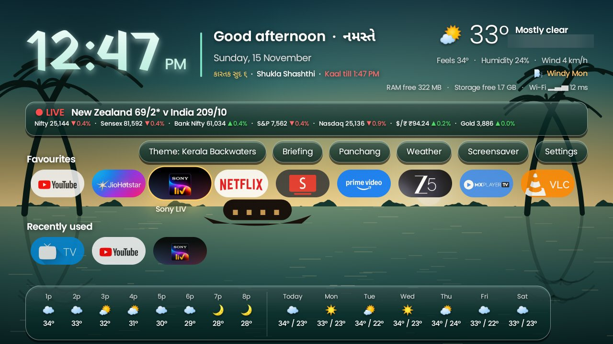

**Fastest install:** turn on [ADB over Wi-Fi](#step-1-turn-on-adb-over-wi-fi-on-the-tv), then [ask Claude to do it](#path-a-let-claude-install-it-fastest).

## What you get

**Home screen**
- Big clock, time-of-day greeting (English / हिन्दी / ગુજરાતી), date
- Weather for your area with feels-like, humidity, wind and an air-quality warning; hourly and 7-day strip
- Favourites and Recently used rows, HDMI inputs that show the connected device and whether it's on (HDMI-CEC)
- Ticker strip: live India / IPL cricket score, big-club football score, Nifty, Sensex, S&P, Nasdaq, $/₹, gold
- 15 themes: Auto (dawn / day / dusk / night) and painted scenes (Kerala Backwaters, Desert Fort, Himalayan Peaks, Temple Lamps, Warli Art, Arctic Aurora, Alpine Lake, Canyon Sunset, Film Noir, Neon City, Retro Bollywood…), all drawn in code
- Festival decorations on the day: Diwali, Navratri, Uttarayan, Holi, Christmas, New Year, Independence / Republic Day and more

**Screens**
- **Briefing:** Indian, US and global indices, sector and stock trackers with 5-day charts, an editable watchlist, cricket and football scores, and news (Cricket, Football, Tech, AI, Space, Markets). It can open by itself on the first switch-on of the morning.
- **Weather:** now, warnings, a 3-day walk / jog planner that takes air quality into account, 24 h and 14-day forecasts
- **Panchang:** tithi, nakshatra, yoga, karana, Choghadiya, Rahu Kaal, sunrise / sunset and upcoming festivals, worked out offline for your location
- **Network monitor:** uptime, latency chart, outages, speed test
- **TV stats:** RAM, storage and CPU before vs after

A full tour with the remote is in **[docs/FEATURES.md](docs/FEATURES.md)**.

**Screensavers:** Nebula Drift, Aurora, Warp Speed, Rangoli Mandala, Minimal Clock, Facts & Quotes, Briefing, Panchang, photo packs (Monuments, Nature, Animals, Baby animals, Space, from Wikimedia featured pictures) and your own photos from a USB stick

**Extras**
- Live score pop-ups over any app or HDMI input (a wicket, every 50 runs, goals)
- Market alerts when an index moves 1% or a watchlist stock moves 5%
- Sleep timer, tick / click sounds, night mode for the screensaver
- **Settings → Features** (or **Briefing → Customise**): switch off whole features you don't care about, such as markets, cricket, football, Panchang or any news section. Switched-off features are not downloaded and disappear from home, Briefing, the screensaver and pop-ups.
- If home ever fails to load, a plain "safe mode" app list appears instead of a black screen

All data comes from free public feeds that need no API keys: Open-Meteo, Yahoo Finance (delayed, display only), ESPNcricinfo, ESPN, BBC, NASA, Ars Technica, TechCrunch, MIT Technology Review, Google News and Wikimedia.

## Screenshots

| | |
|---|---|
| 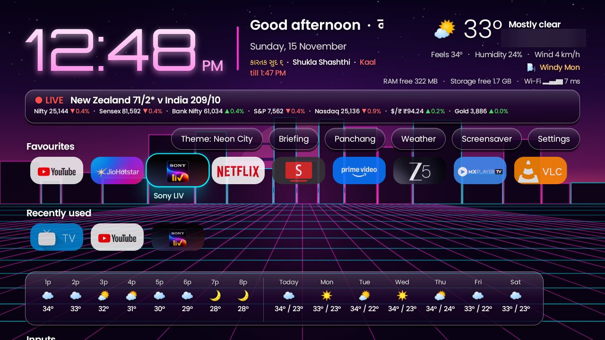 Neon City theme | 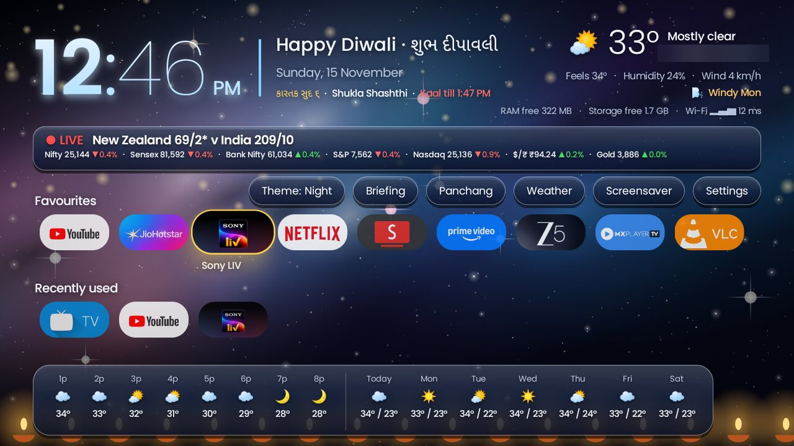 Festival day: Diwali |
| 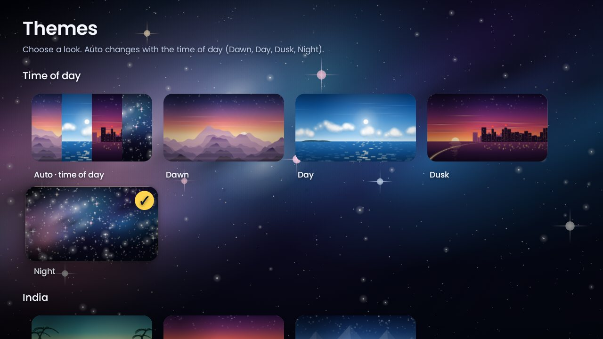 Theme gallery | 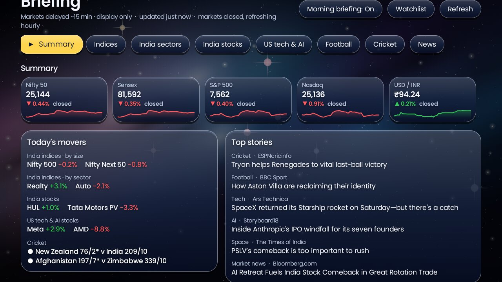 Briefing: markets, scores, news |
| 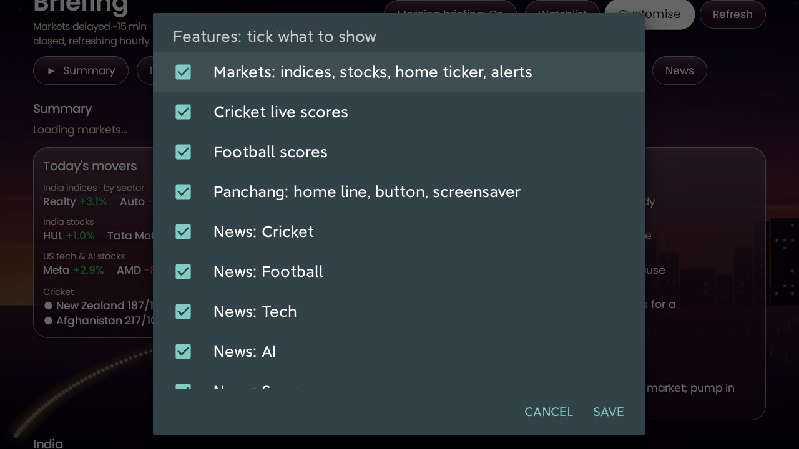 Settings → Features | 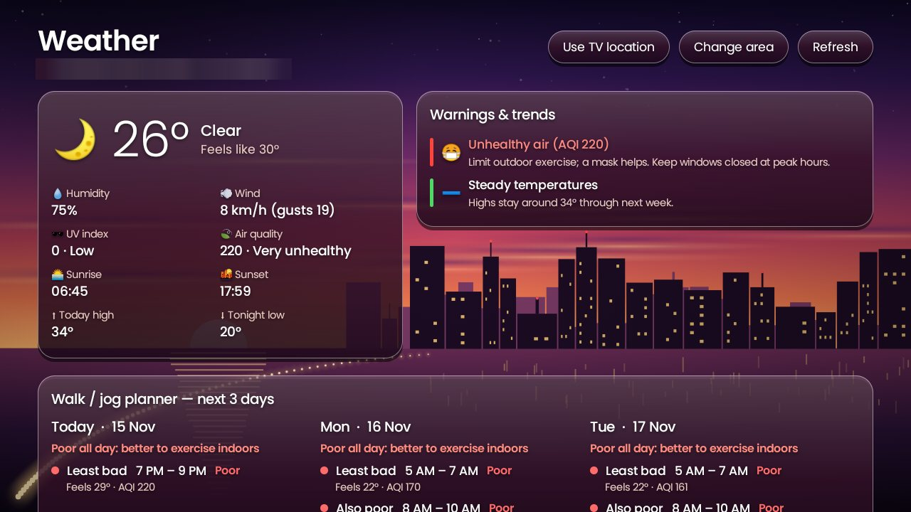 Weather and walk / jog planner |
| 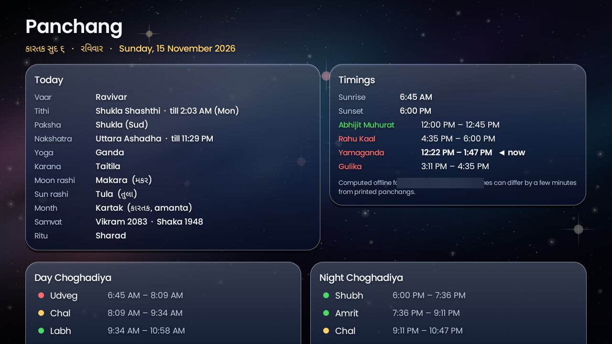 Panchang, worked out offline | 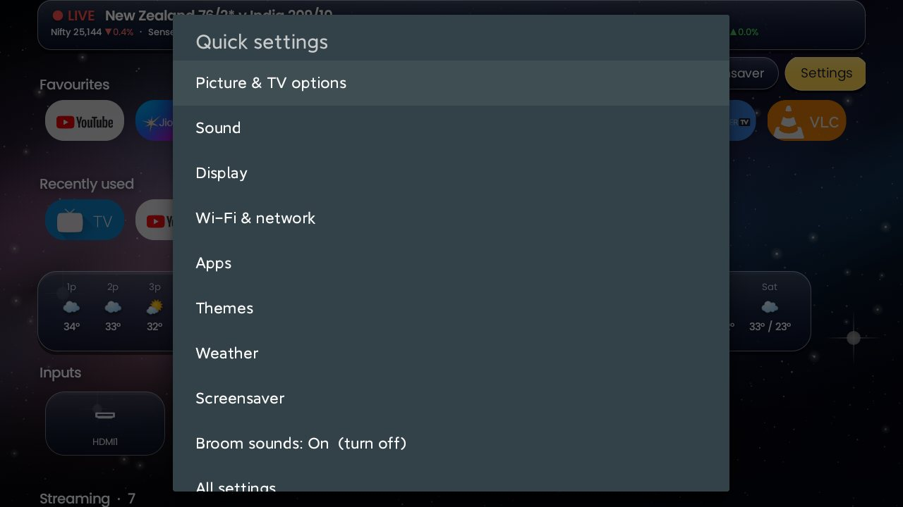 Quick settings |
| 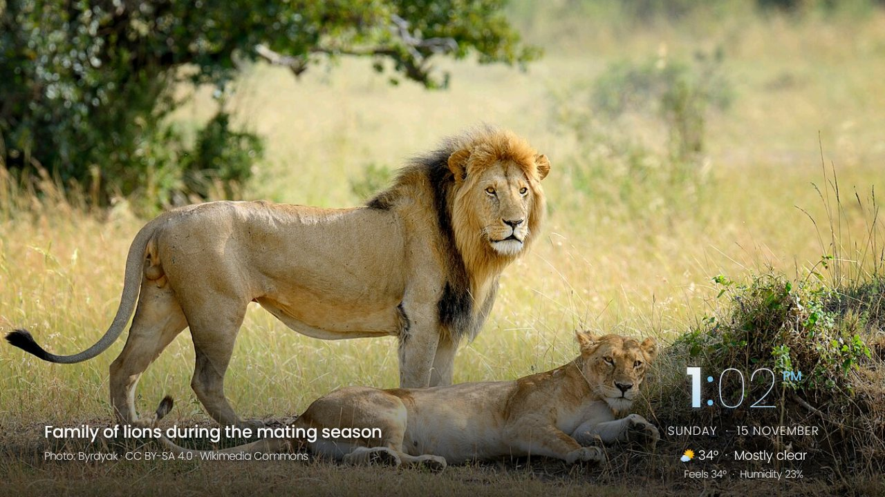 Screensaver: Animals photo pack | 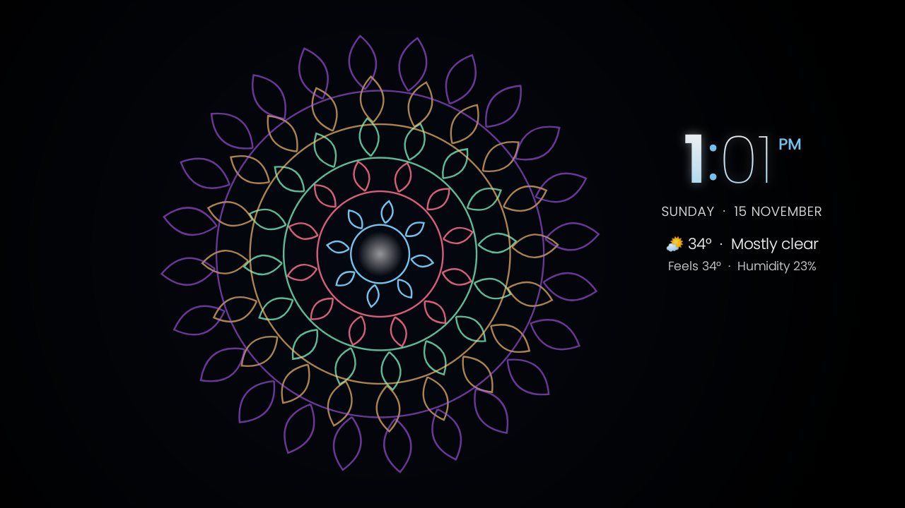 Screensaver: Rangoli Mandala |

## Install: do I need to build anything?

**No.** Most people never build. Everyone does [Step 1](#step-1-turn-on-adb-over-wi-fi-on-the-tv) on the TV first, then picks one path:

| | Path A: let Claude install it | Path B: run the script yourself | Path C: build from source |
|---|---|---|---|
| Who | Anyone, no technical steps | Comfortable with a terminal | People changing the code |
| You need | [Claude Code](https://claude.com/claude-code) on a computer on the same Wi-Fi | A computer on the same Wi-Fi and ADB | The same, plus Android SDK, JDK 17 and Python 3 |
| Time | About 5 minutes | About 10 minutes | About 30 minutes the first time |
| Steps | [Path A](#path-a-let-claude-install-it-fastest) | [Path B](#path-b-run-the-installer-yourself-no-build) | [Path C](#path-c-build-from-source) |

### Why a computer (ADB) is needed once

Broom isn't on the Play Store, so it has to be **side-loaded**, which just means installed from an APK file. Copying the APK to the TV on a USB stick will install it, but on its own it's then just another app you open from the app list. **The TV's own home screen (PatchWall, Android TV home or Google TV home) keeps the Home button.**

To make Broom the **real home screen**, these have to be switched on from a computer over ADB:
- Home button → Broom
- Broom opens at power-on
- Broom's screensaver
- Weather location
- Screensaver timers

Many TVs (Mi TVs included) hide or restrict the settings that would let you do this on the TV itself. The installer script does all of it in one go. You do it once per TV, and again only if a system update undoes it.

Only Broom is side-loaded. Your other apps (Netflix, YouTube, Hotstar…) stay as they are, and you keep installing apps from the Play Store as usual.

### Step 1: turn on ADB over Wi-Fi on the TV

Do this once, with the remote. It lets a computer on your Wi-Fi send setup commands to the TV.

1. **Connect the TV to the same Wi-Fi** as your computer.
2. **Unlock Developer options:** open **Settings** (the gear icon on the TV's home screen) → **Device Preferences** → **About** → scroll to **Build** and press **OK 7 times**. You'll see "You are now a developer".
3. **Turn on debugging:** go Back to **Device Preferences** → **Developer options** → **USB debugging: On** → OK. Despite the name, on most Android TV 9–10 TVs (Mi TVs included) this also turns on **ADB over Wi-Fi on port 5555**. No cable needed.
   On **Android TV 11+ / Google TV**, also turn on **Wireless debugging** in the same menu. It shows an IP, a port and a pairing code; you (or Claude) will need those. Details: [docs/COMPATIBILITY.md](docs/COMPATIBILITY.md#things-that-depend-on-the-tv-not-on-broom).
4. **Find the TV's IP address:** Settings → **Network & Internet** → select your Wi-Fi network → **IP address**, for example `192.168.1.50`. Write it down.
   Tip: in your router's settings, reserve this IP for the TV so it doesn't change.
5. Leave the TV **switched on, showing any screen**. The first time a computer connects, the TV asks **"Allow USB debugging?"**. Tick **Always allow from this computer** and press **OK**.

To turn this off again after setup, set Developer options → USB debugging to Off. Turn it back on only when you need to re-run the installer.

### Path A: let Claude install it (fastest)

[Claude Code](https://claude.com/claude-code) can run commands on your computer, so it can install ADB, connect to the TV and run the installer for you. Use the **Code** tab in the Claude desktop app, or `claude` in a terminal. The normal claude.ai chat in a browser can't reach your TV.

1. Do [Step 1](#step-1-turn-on-adb-over-wi-fi-on-the-tv) on the TV.
2. Open Claude Code in any folder and paste this, with your TV's IP:

   ```text
   Install Broom Home on my <brand and model> TV from https://github.com/jignesh-rav/broom-home
   My TV's IP is 192.168.1.50 and USB debugging is on (Step 1 of the README is done).
   Clone the repo, follow its CLAUDE.md, install adb if it's missing, and run the installer.
   Ask me before debloating or turning on the ad-blocking DNS.
   ```
3. When Claude says it's connecting, look at the TV and accept **"Allow USB debugging?"**.
4. Press **Home** on the remote.

Claude follows [`CLAUDE.md`](CLAUDE.md), which spells out the steps, the checks to run afterwards and what it must never touch. You can also ask it for more afterwards, for example "debloat my TV but keep Mi screen mirroring", "undo everything", "switch off the markets feature", or "change the watchlist to US stocks only and rebuild".

**Not a Xiaomi TV?** Installing Broom and making it the default launcher works the same way. Debloating and the Stats page's "before / after" numbers take a few extra steps, which Claude handles once Broom is in:
1. It snapshots your TV before any change.
2. It lists your model's packages, sorted into junk / caution / keep, and disables only what you approve.
3. It snapshots again afterwards.
4. It rebuilds the Stats page with your TV's numbers.

Ask: *"…then help me debloat my &lt;brand and model&gt; TV and update the Stats page for it."* Details: [docs/COMPATIBILITY.md](docs/COMPATIBILITY.md#on-non-xiaomi-tvs-whats-the-same-and-what-needs-extra-steps).

### Path B: run the installer yourself (no build)

1. Do [Step 1](#step-1-turn-on-adb-over-wi-fi-on-the-tv) on the TV.
2. **Install ADB on your computer**:
   - Windows: `winget install Google.PlatformTools`
   - macOS: `brew install android-platform-tools`
   - Linux: `sudo apt install adb`
3. **Download this repo:** the green **Code** button → **Download ZIP**, then unzip it.
4. **Run the installer** from the `scripts` folder. It downloads the latest `BroomHome.apk` from [Releases](../../releases/latest) by itself:

   Windows: open the `scripts` folder, Shift + right-click on an empty spot → **Open PowerShell window here**, then:
   ```powershell
   powershell -ExecutionPolicy Bypass -File .\install.ps1 -Tv 192.168.1.50
   ```
   macOS / Linux (Terminal, inside `scripts`):
   ```bash
   ./install.sh 192.168.1.50
   ```
5. **On the TV**, accept **"Allow USB debugging?"**. Tick *Always allow from this computer*.
6. Press **Home** on the remote. You're on Broom. If the TV asks which Home app to use, choose **Broom Home → Always**.

Then take the tour in **[docs/FEATURES.md](docs/FEATURES.md)**.

**Optional extras** (add them to the install command):

| Windows | macOS / Linux | What it does |
|---|---|---|
| `-Debloat` | `--debloat` | **Xiaomi Mi TVs only** (other brands: use Path A and ask Claude). Disables the packages in [`scripts/debloat-list.txt`](scripts/debloat-list.txt): telemetry, ad rows, and services a TV doesn't need. Edit the list first; each one is explained in [docs/DEBLOAT.md](docs/DEBLOAT.md) |
| `-AdBlockDns` | `--adblock-dns` | AdGuard private DNS: blocks ads and trackers for the whole TV |
| `-Apk path\to.apk` | `APK=path/to.apk ./install.sh …` | Use an APK you already have instead of downloading |

**After a TV system update**, run the same command again. It's safe to repeat and only fixes what's missing.

**Undo everything:** `powershell -ExecutionPolicy Bypass -File .\undo.ps1 -Tv 192.168.1.50` (or `./undo.sh 192.168.1.50`), then reboot the TV.

**No computer at all?** An Android phone with an ADB app can do the same job. See [docs/SETUP.md](docs/SETUP.md#no-computer-use-an-android-phone).

### Path C: build from source

Only needed if you change the code. No Android Studio or Gradle. You need:
- the Android SDK command-line tools with `build-tools` and `platforms;android-28`
- JDK 17 or newer
- Python 3

```bash
cd launcher
./build.sh                                   # -> launcher/build/BroomHome.apk  (Windows: run in Git Bash)
cd ../scripts && ./install.sh 192.168.1.50   # the installer picks up your fresh build automatically
```
The first build creates your own signing key, `launcher/broom.keystore`. Keep it: Android only accepts updates signed with the same key. Moving between the release APK and your own build means uninstalling first, because they're signed with different keys. Details: [docs/SETUP.md](docs/SETUP.md#building).

## Make it yours

The code is plain Java with no libraries, one file per screen. [docs/CUSTOMISE.md](docs/CUSTOMISE.md) shows where to change:
- the default stock lists and news feeds
- greetings and quotes
- themes, festivals and favourites

## Is a newer Android possible on these TVs?

No. The bootloader is locked and there are no custom ROMs. The research is in [docs/OS-UPGRADE.md](docs/OS-UPGRADE.md).

## Safety notes
- Debloating only *disables* packages (`pm disable-user`). Nothing is deleted, and `undo` re-enables everything.
- Never disable `com.droidlogic.*`, Bluetooth, the remote service, `com.android.tv`, Google Assistant, Play services, Play Store, Chromecast or `com.xiaomi.mitv.updateservice`. The list leaves them alone.
- Don't `am force-stop com.broom.launcher`. Android then drops the remote-button helper until you re-run the installer or reboot.
- Market data is delayed and for display only. It is not investment advice.

## License
MIT, see [LICENSE](LICENSE). The fonts in `launcher/assets/fonts` are under the SIL Open Font License (`OFL.txt`).
